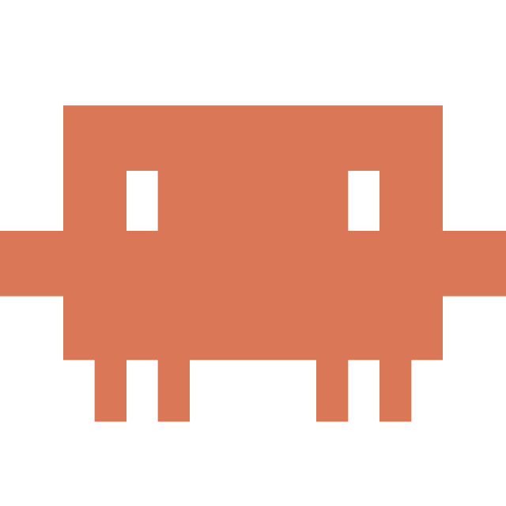
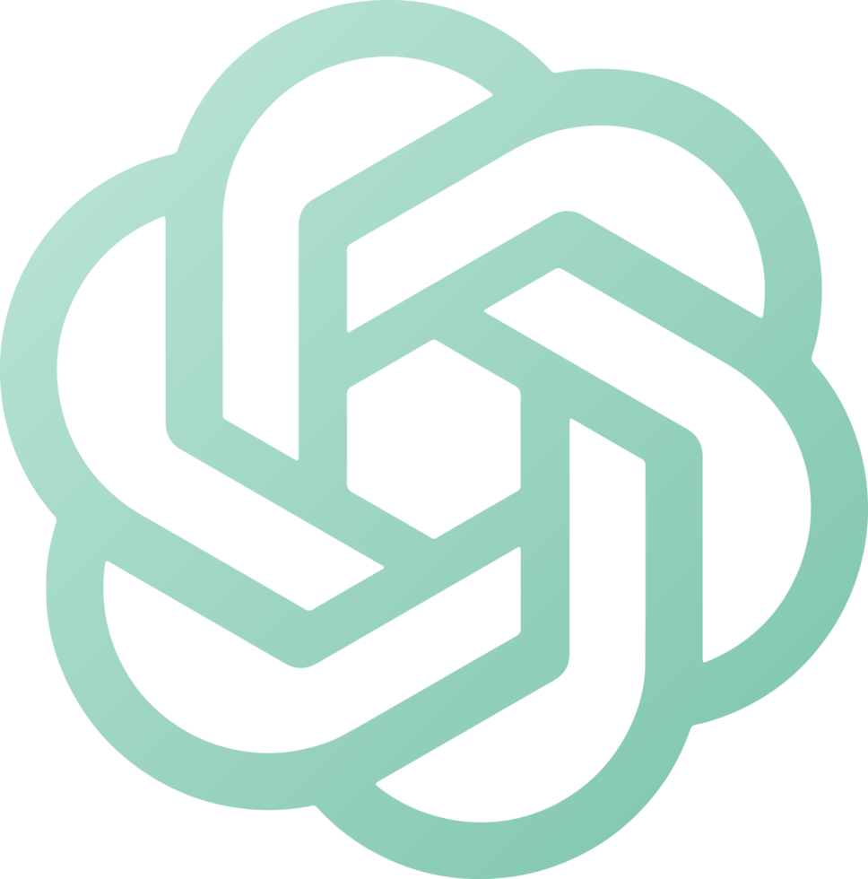
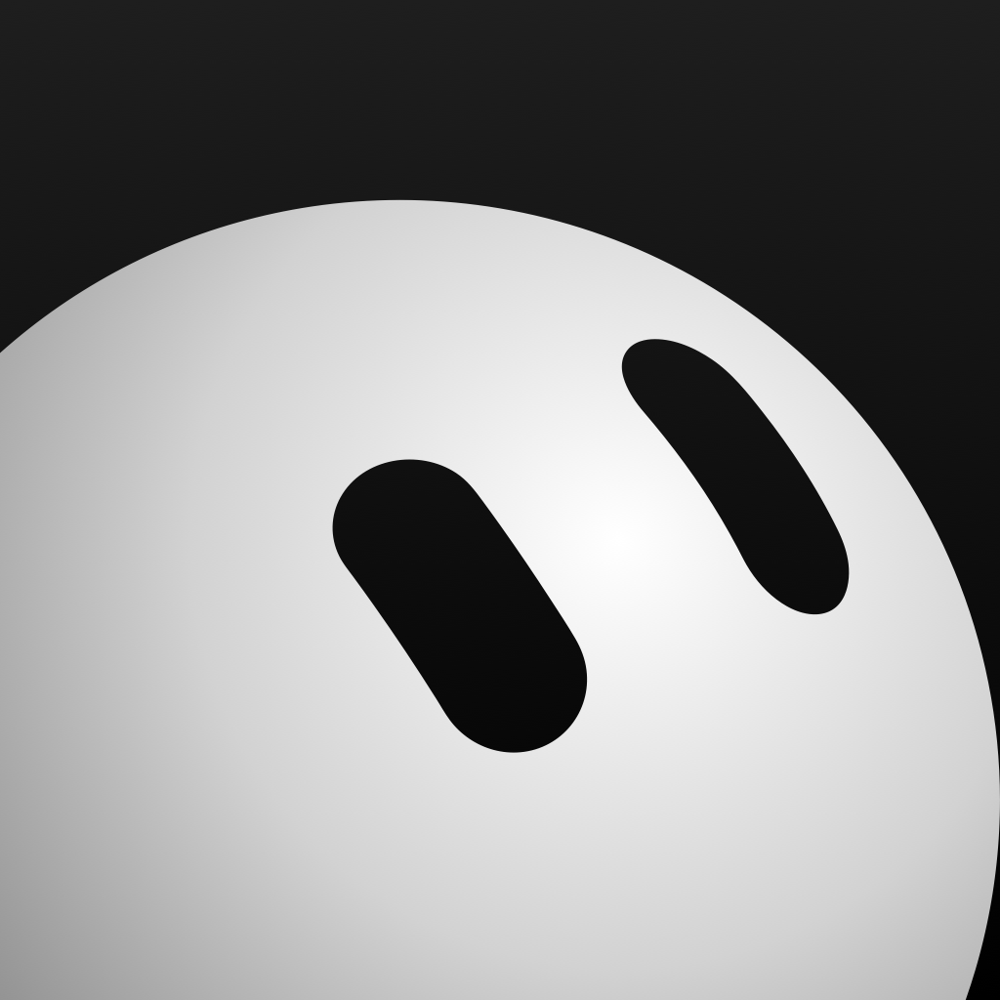
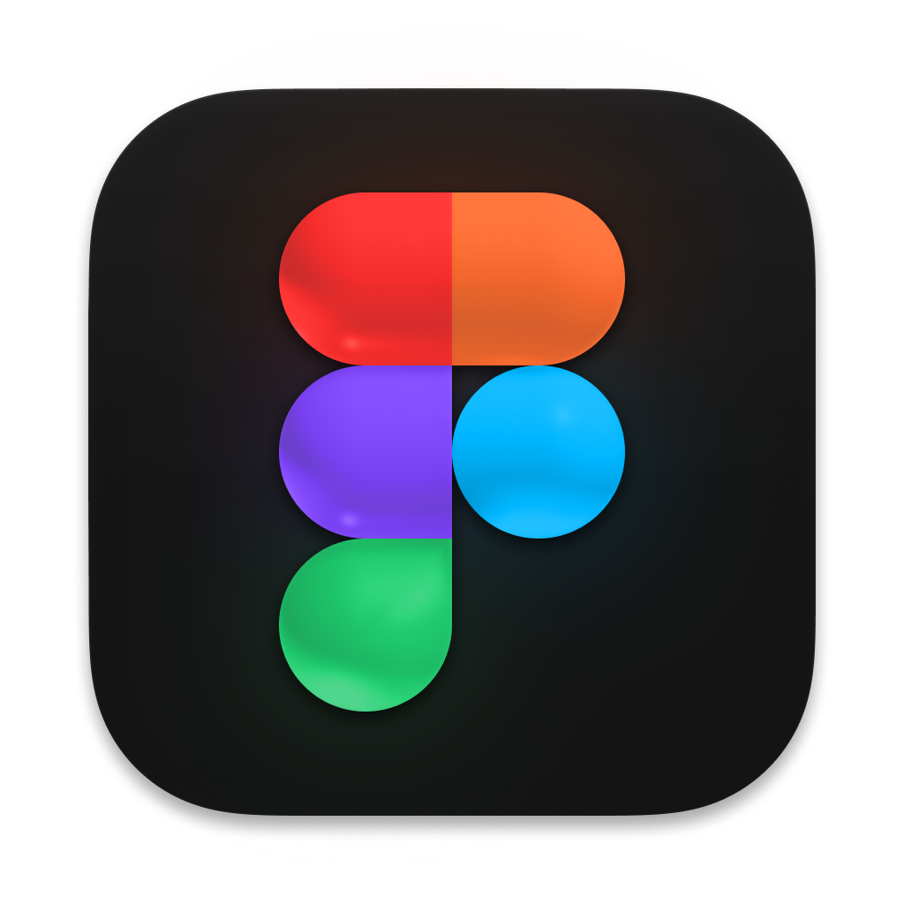
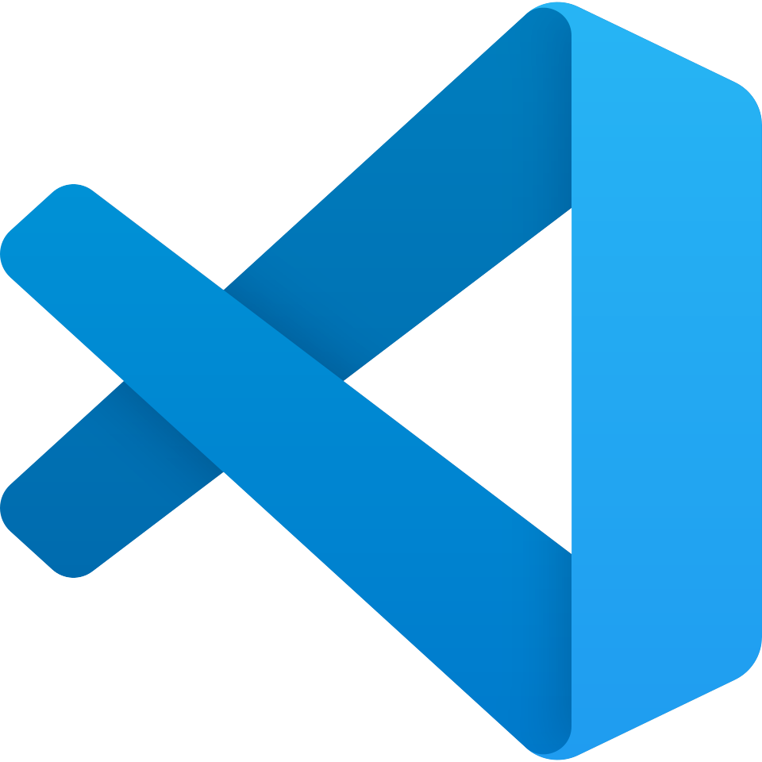
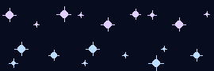

# Logitech MX Creative Console workflows

A reusable set of workflows for turning the nine-key Logitech MX Creative Console keypad into an app-aware launcher and workflow surface for Codex, Claude Code, Cursor, Figma/FigJam, GitHub, VS Code, and other tools.

These are the source files and layouts behind my daily keypad setup. You can build the plugins, install their actions, and map the same layouts onto your own Logitech keypad.

## Quick start

```bash
git clone https://github.com/conniexu444/logitech-mx-keypad-workflows.git
cd logitech-mx-keypad-workflows
./scripts/check-prerequisites.sh
./scripts/build.sh
./scripts/install-plugins.sh
```

Restart Logi Options+, then use [map-actions.md](docs/map-actions.md) to place the actions on your keypad. The installer adds the reusable actions; it does not overwrite your existing pages or button assignments.

## Homepage assets

The exact seven launcher images are included in [`assets/homepage`](assets/homepage):

<p>
  
  
  
  
  
  
  
</p>

Use Logi Options+’s **Replace icon** control and select the matching PNG.

## Animated buttons



The repository includes the full workflow behind the three synchronized pulsing-star buttons: a frame generator, a Logitech plugin that refreshes the key images at 10 FPS, and instructions for adapting it to your own animation.

Read **[Animated buttons: the three-key Starlight workflow](docs/animated-buttons.md)** for the step-by-step explanation.

## What the setup does

The default page is an app launcher. Opening an app activates its own keypad profile:

- **Codex:** three most recent tasks, task navigation, reusable prompts, Git/PR commands, and local Whisper dictation.
- **Claude Code:** launch a terminal session and organize voice/project commands.
- **Cursor:** navigation, Agent prompts, review, tests, Git, and PR creation.
- **Figma/FigJam:** create a FigJam board and select common shape tools.
- **Grok Bot:** app launcher or a custom command page.
- **Starlight:** a three-key pulsing-star animation used as decorative filler.

See [the exact layouts](docs/layouts.md), [how the pieces fit together](docs/architecture.md), and the [Claude/Grok recipes](docs/claude-and-grok.md).

## Requirements

- macOS on Apple silicon
- Logitech MX Creative Console with Logi Options+
- The desktop apps you choose to map
- .NET SDK 10 for custom Logitech plugins
- Python 3 and Pillow for generated icons
- Optional: `whisper.cpp` for local dictation

Run:

```bash
./scripts/check-prerequisites.sh
```

## Install manually or customize

Logitech does not currently expose these profile files as a stable public configuration API. Back up your current setup before experimenting:

```bash
./scripts/backup-logi-config.sh
```

Then follow [setup.md](docs/setup.md). The source under `src/` is separated by workflow so you can install one plugin or customize its prompts without adopting the entire setup.

## Personal data and security

The repository does not contain my personal paths, task database, recordings, or credentials because those would not work for anyone else. Read [privacy.md](docs/privacy.md) before publishing your own exported profile. Codex recent-task buttons query only task IDs from your local Codex database; voice transcription runs locally.

## Project status

This is a community reference project, not an official Logitech, OpenAI, Anthropic, Cursor, Figma, GitHub, or xAI product. Application menu names and Logitech internals can change after updates.

## License

MIT. Product names and trademarks belong to their respective owners. Bring your own icons or generate neutral ones with the included scripts.
